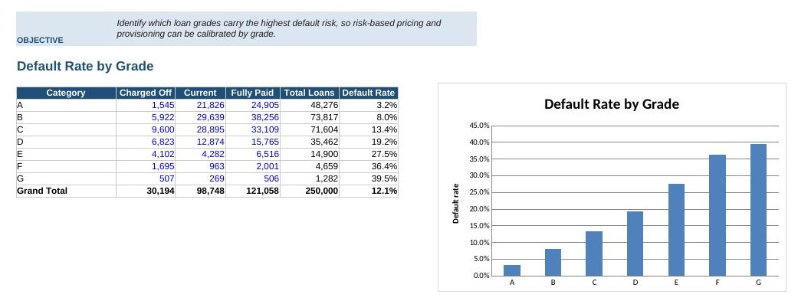
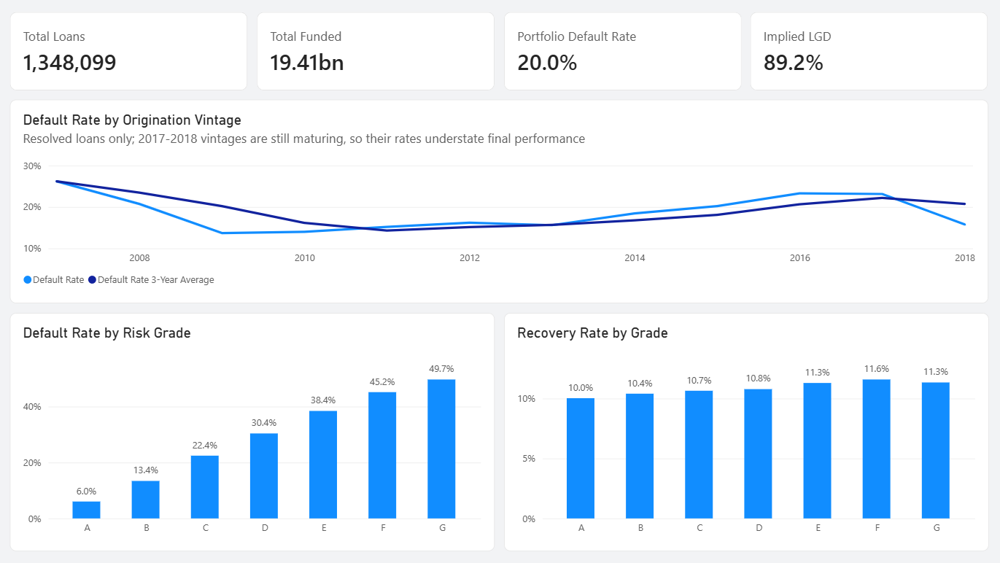
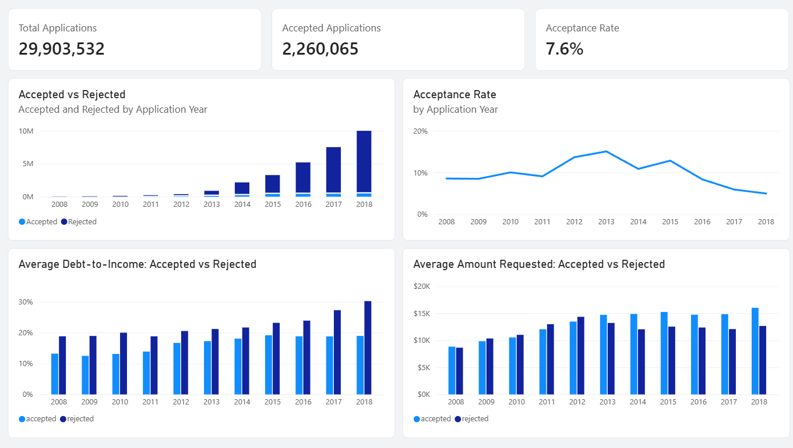
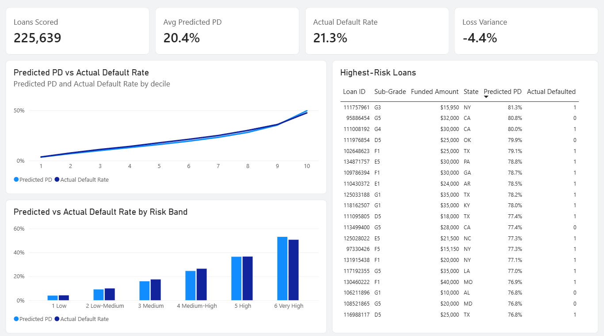

# Credit Risk Analytics and Default Prediction

## Project Overview

This project analyses consumer lending risk using the full LendingClub loan history from 2007 to 2018, covering 2.26 million funded loans and 27.6 million declined applications.

The objective was to answer the three questions a lender faces on every application: who should be approved, how much a bad loan actually costs, and whether the existing portfolio is becoming riskier over time.

The project combines SQL data warehousing, Excel analysis, Python machine learning, and business intelligence reporting to demonstrate a complete end-to-end credit risk workflow at production data scale.

---

## Business Problem

Consumer lenders earn interest on loans that perform and lose principal on loans that default. Pricing that risk correctly is the difference between a profitable and an unprofitable loan book.

The goal of this project was to:

- Measure default rates and dollar losses across the loan portfolio
- Build a probability of default (PD) model using only information available at origination
- Estimate loss given default from actual recovery data rather than assumption
- Analyse the underwriting funnel using declined applications
- Deliver monitoring dashboards and reporting for ongoing portfolio surveillance

---

## Tools & Technologies

- SQL (SQLite)
- Python (pandas, scikit-learn)
- Microsoft Excel
- Power BI
- GitHub

---

## Project Workflow

### 1. Data Cleaning and Exploration

Before any warehouse or model existed, the raw accepted-loans file was worked through cell by cell in `Python/data_preparation/data_cleaning_and_exploration.ipynb`.

The raw file is not clean UTF-8, so the first attempt to count its rows fails outright. From there the work was separating loans that had reached a final outcome from loans still running, stripping out the fields a lender would not have at the point of approval, auditing how empty each column was, deriving credit history length and employment length as usable numbers, aligning the training and scoring datasets to the same shape, and filling what remained according to what each blank actually meant.

Columns were removed across several passes rather than one, because the fields that leak an outcome are not obvious from their names. Searching the column list for `rec_`, `recover`, `next_`, `hardship` and `settlement` is what surfaced them.

The notebook is published as it was worked, failed cell included, because the failures are part of what the raw data does.

### 2. Data Warehouse

Loaded both raw source files into a SQL warehouse, since the accepted file exceeds Excel's row limit by 2x and the rejected file by 26x.

- `raw_accepted` — 2,260,668 loans across 85 curated columns
- `raw_rejected` — 27,648,741 declined applications
- Indexed on grade, state, loan status and issue date

Two analytical views sit on top of the raw tables:

- `vw_loan_performance` — one row per resolved loan, with a default flag, net loss and recovery rate. Loans still open are excluded so the default rate is not understated.
- `vw_applications_funnel` — accepted and rejected applications unioned at a common grain for acceptance-rate analysis.

### 3. SQL Analysis

Eight analytical queries covering vintage default trends, underwriting acceptance rates by state and year, grade scorecards, recovery analysis, monthly issuance trends, purpose-within-grade risk, and state exposure concentration.

Concepts used: CTEs, window functions (`RANK`, `LAG`, moving averages), `HAVING`, conditional aggregation, date parsing and cohort analysis.

The output of every query is published in [`SQL/04_query_results.md`](SQL/04_query_results.md), generated by running them against the rebuilt warehouse rather than transcribed by hand. `SQL/03_run_queries.py` regenerates that file, so the results stay in step with the queries.

The grade scorecard, as Q4 returns it:

| grade | loans | funded | avg rate | default rate | net loss | loss rate |
|---|---|---|---|---|---|---|
| A | 235,193 | $3.26B | 7.11% | 6.04% | $103.4M | 3.17% |
| B | 393,102 | $5.20B | 10.66% | 13.40% | $407.7M | 7.84% |
| C | 382,323 | $5.42B | 14.07% | 22.44% | $789.9M | 14.58% |
| D | 201,657 | $3.07B | 17.76% | 30.38% | $645.8M | 21.01% |
| E | 94,192 | $1.65B | 21.14% | 38.43% | $454.2M | 27.48% |
| F | 32,306 | $0.61B | 24.92% | 45.15% | $207.3M | 33.76% |
| G | 9,326 | $0.19B | 27.61% | 49.67% | $71.7M | 37.70% |

### 4. Excel Analysis



A ten-sheet analytical workbook built on a 250,000-loan sample, with a stated objective on every sheet, live formulas, and charts covering default rates by grade, purpose, home ownership and verification status, plus exposure analysis and a financial model.

### 5. Predictive Modelling

Two generations of PD model were built:

- **v1** — built on an 87,891-loan sample from a single 2015 vintage using a random 75/25 train/test split
- **v2** — trained on 1,122,460 loans issued 2007 to 2016 and tested out-of-time on 225,639 loans issued 2017 to 2018

Out-of-time validation is the standard used in real credit risk model validation, because a random split allows loans from the same vintage to share economic conditions across training and test data, which overstates performance.

Both models exclude data leakage columns. Fields only known after a loan resolves, such as payments received, recoveries, updated FICO scores and hardship flags, are removed so the model uses only information available at the point of approval.

A missingness audit dropped 14 further features that were more than 50% empty in the training window, preventing the model from learning field availability as a proxy for how recent a loan is.

### 6. Reject Inference Analysis

An acceptance model was built on the fields shared by accepted and declined applications, to analyse what separates an approved application from a rejected one.

This analysis also surfaced a data quality issue. Employment length is recorded as "less than 1 year" for 83.0% of rejected applications compared to 8.4% of accepted ones, which is a form default rather than a real signal. Including it raised model AUC from 0.672 to 0.908, so it was excluded from the reported model.

### 7. Power BI Reporting

A three-page Power BI report was built on the modelled data, using twenty DAX measures over twelve aggregate tables and the scored-loan fact table.

**Page 1 — Portfolio Performance**



Vintage default rates with a trailing three-year moving average, the grade scorecard, and recovery rates by grade. The vintage chart carries a note that the 2017 and 2018 cohorts are still maturing, because those loans have had less time to reach charge-off and their rates understate final performance.

**Page 2 — Underwriting Funnel**



The 29.9 million applications behind the funded book. Acceptance rate peaks at 15.1% in 2013 and falls to 5.0% by 2018 while annual application volume grows from 28,000 to 10 million. Debt-to-income separates the two populations cleanly, from 12.5-19.1% on accepted applications against 18.8-30.2% on declined ones.

**Page 3 — Model and Risk**



The v2 model measured against the 225,639 loans in the out-of-time test set: predicted against actual default rate by decile and by risk band, and a watchlist of the twenty highest-risk loans with the outcome that actually occurred. Fifteen of the twenty defaulted.

The Power BI file, the import layer that feeds it and a click-by-click build guide are all in `PowerBI/`.

---

## Model Performance

| Metric | v1 (random split) | v2 (out-of-time) |
|----------|----------|----------|
| Training loans | 65,918 | 1,122,460 |
| Test loans | 21,973 | 225,639 |
| AUC | 74.4% | 71.8% |
| KS Statistic | 36.0% | 31.8% |
| Brier Score | 0.139 | 0.151 |

**Selected Model:** HistGradientBoostingClassifier

Both generations used a Logistic Regression baseline and a gradient boosting model, with gradient boosting selected in each case. The v2 model scores lower than v1 despite training on seventeen times more data, because out-of-time validation is a harder and more realistic test. The v1 figures are closer to what a random split reports than to what the model would deliver in production.

---

## Key Findings

- Risk grading is effective. Default rates climb consistently from 6.0% for grade A loans to 49.7% for grade G, with loss rates rising from 3.2% to 37.7% of funded principal.
- The overall portfolio default rate across all resolved loans is 20.0%.
- Loss given default is approximately 90% across every risk grade. Recoveries through collections return only 10.0% to 11.6% of the unpaid balance, and this is remarkably stable regardless of borrower quality.
- Interest rate, loan term, loan amount and debt-to-income ratio are the strongest predictors of default.
- The model is well calibrated on unseen data. Across six risk bands on the out-of-time test set, predicted probability tracks the actual default rate closely, from 3.9% predicted against 4.1% actual in the lowest band to 53.1% predicted against 50.6% actual in the highest.
- Applying the measured 90% loss given default to the scored book gives an expected loss of $662.6M against $693.2M actually incurred, so the model under-predicts losses by 4.4%. For provisioning the direction matters more than the size: a model that understates losses produces reserves that are too thin.
- Exposure concentration and risk concentration are not the same. California, Texas and New York carry the largest exposure at $2.89B, $1.67B and $1.57B, but New York defaults at 22.1% against California's 19.6%.
- Debt-to-income ratio is the strongest legitimate driver of approval decisions, and adding a credit score proxy raises acceptance model AUC from 67.2% to 85.5%.

---

## Business Recommendations

- Replace flat loss assumptions with the observed 90% loss given default when provisioning, as recoveries are consistently minimal.
- Validate credit models out-of-time before deployment, since random splits overstate expected performance.
- Review pricing on grade E to G loans, where default rates approach 50% and loss rates exceed a third of principal.
- Monitor state-level risk separately from state-level exposure, as the two do not move together.
- Treat declined application data as an analytical asset for underwriting review, with attention to fields that carry form defaults rather than real values.

---

## Limitations

- Loss given default is measured at charge-off and does not discount later recoveries or account for time value of money.
- The credit score proxy compares LendingClub's risk score for declined applications against FICO ranges for approved loans. These are similar measures but not confirmed to share a scale.
- The PD model contains no macroeconomic variables, so it describes default patterns without explaining the economic cycle behind them.
- The Power BI report is built against a static extract rather than a live connection, so it does not refresh on its own.
- Full reject inference techniques such as fuzzy augmentation were scoped out in favour of a standalone acceptance model.

---

## Repository Structure

```text
Dataset/
Excel/
PowerBI/
Python/
Report/
SQL/
README.md
```

## Skills Demonstrated

- SQL Data Warehousing
- Window Functions and CTEs
- Cohort and Vintage Analysis
- Data Cleaning at Scale
- Feature Engineering
- Data Leakage Prevention
- Out-of-Time Model Validation
- Predictive Modelling and Machine Learning
- Model Evaluation (AUC, KS, Brier, Decile Lift)
- Excel Analysis and Dashboarding
- Power BI Data Modelling and DAX
- Credit Risk Domain Analysis

---

## Author

Umer Jamal
